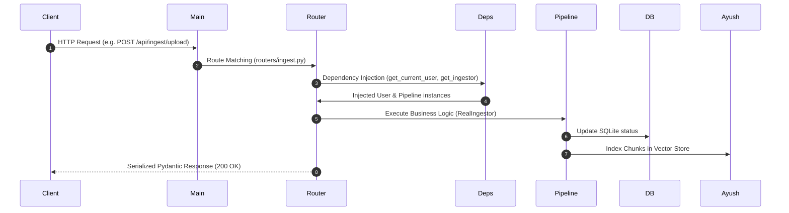

# Rachit Patnaik — Master Study Guide: Core Backend, Ingestion & Authentication

As the Backend Architecture and Ingestion Lead, you own the core FastAPI service, document processing, database persistence, and API routing. You also have a **mandatory requirement to fully master Amit's authentication and authorization implementation** so you can explain it authoritatively during presentations and technical vivas.

---

## 1. FastAPI Application Architecture

Implemented in `backend/app/main.py`:
- **Framework:** FastAPI running on Uvicorn ASGI server.
- **Middleware:** `CORSMiddleware` configured to allow cross-origin requests from the Vite frontend (`http://localhost:5173`, `http://127.0.0.1:5173`).
- **Router Mounting:**
  - `/api/auth` $\to$ `auth.router` (Amit's auth endpoints)
  - `/api/ingest` $\to$ `ingest.router` (Upload, list, delete)
  - `/api/query` $\to$ `query.router` (Hybrid search & answering)
  - `/api/system` $\to$ `system.router` (Governance, page rendering, health)
  - `/api/eval` $\to$ `eval.router` (Evaluation & benchmarks)

---

## 2. API Routes & Request/Response Lifecycle



---

## 3. Document Ingestion & Processing Pipeline

Implemented across `backend/ingest/`:
1. **Validation (`routers/ingest.py`):**
   - File extension must be `.pdf`.
   - Magic bytes must start with `%PDF`.
   - File size must not exceed `settings.max_file_size_mb` (50MB).
2. **Text Parsing (`parser.py`):**
   - Uses PyMuPDF (`fitz`) to open PDF stream.
   - Extracts page-level text blocks, font sizes, bounding boxes, and image counts.
3. **Table & Layout Extraction (`extractors.py`):**
   - Detects structured table blocks.
   - Renders page pixmap and calls Groq Vision (`llama-3.2-11b-vision-preview`) to transcribe tabular data into clean Markdown.
4. **Structure-Aware Chunking (`chunker.py`):**
   - Splits text into ~500-token chunks with ~100-token overlap.
   - Emits structured `EvidenceChunk` objects with `page`, `bbox`, `document_id`, and `section_title`.
5. **Auto-Approval & Indexing (`pipeline.py`):**
   - Calls `indexer.add(chunks)` to push embeddings into Ayush's `ResilientCollection`.
   - Transitions document status to `APPROVED` in SQLite.

---

## 4. SQLite Database & Document Lifecycle

Implemented in `backend/core/db.py`:
- **Engine:** SQLite 3 in WAL (Write-Ahead Logging) mode, providing high-speed concurrent reads.
- **Tables:**
  - `documents`: Stores `file_id`, `filename`, `status`, `total_pages`, `total_chunks`, `created_at`.
  - `staging_chunks`: Holds parsed chunks before publishing.
  - `decisions`: Governance audit log of approvals, rejections, and holds.
  - `vector_collection`: Binary BLOB storage for 384-d vector embeddings.
- **Document Status Transitions:**
  $$\text{DRAFT} \longrightarrow \text{PENDING\_REVIEW} \longrightarrow \text{APPROVING} \longrightarrow \text{APPROVED}$$
  $$\text{PENDING\_REVIEW} \longrightarrow \text{REJECTED} \quad \text{or} \quad \text{ON\_HOLD}$$

---

## 5. Communication with Ayush's Retrieval Subsystem

- During ingestion, Rachit's `pipeline.py` obtains the active indexer via `deps.get_indexer()` and calls `indexer.add(chunks)`.
- During query execution, Rachit's `query.py` obtains the retriever via `deps.get_retriever()` and calls `retriever.retrieve(question, top_k)`.
- Data contract: `EvidenceChunk` (ingestion) and `RetrievedChunk` (retrieval output).

---

## 6. Communication with Amit's Generation Subsystem

- In `routers/query.py`, after retrieval and reranking, the router calls `answerer.answer(question, evidence)`.
- Consumes Amit's returned answer, citations, and trust breakdown:
  ```python
  answer, citations = answerer.answer(req.question, reranked_chunks)
  breakdown, refused = trust_layer.evaluate(req.question, answer, citations, reranked_chunks)
  ```

---

## 7. Configuration & Environment Settings

Implemented in `backend/app/config.py` using `pydantic-settings.BaseSettings`:
- Reads variables from `.env` with strong type validation:
  - `GROQ_API_KEY`, `GROQ_API_KEY_2`, `GROQ_API_KEY_3`
  - `DEV_AUTH_SECRET`, `ENABLE_DEV_AUTH`
  - `EMBEDDING_MODEL`, `TOP_K`, `REFUSAL_THRESHOLD`
  - `UPLOAD_DIR`, `CACHE_DB`

---

## 8. Error Handling, Validation & Security

- **Pydantic Validation:** All request bodies are strictly validated; invalid formats return HTTP 422 with specific field error details.
- **Path Traversal Protection:** File IDs are sanitized using alphanumeric regexes; paths are resolved using `os.path.join(settings.upload_dir, file_id)`.
- **Atomic File Writes:** Uploaded binaries are written to temporary files before moving to destination.

---

## 9. End-to-End Call Flow Traces

- **Ingest:** `POST /api/ingest/upload` $\to$ `ingest.py` $\to$ `pipeline.py` $\to$ `parser.py` $\to$ `chunker.py` $\to$ `index.py (Ayush)` $\to$ `db.py`.
- **Query:** `POST /api/query` $\to$ `query.py` $\to$ `retriever.py (Ayush)` $\to$ `reranker.py (Ayush)` $\to$ `answerer.py (Amit)` $\to$ `trust.py (Amit)`.

---

## 10. MANDATORY AUTHENTICATION & AUTHORIZATION DEEP DIVE (Amit's Code)

Even though Amit owns the implementation code, **you must master this section** to explain it authoritatively to evaluators.

### A. Owned Files
- Implementation: `backend/app/routers/auth.py`
- Dependency & Token Verification: `backend/app/deps.py` (`get_current_user`)
- Tests: `backend/tests/test_batch2b_auth.py`

### B. The Login Flow (`auth.py`)
1. User submits `POST /api/auth/login` with `{ username, password, role }`.
2. The router looks up the user in the hardcoded `ACCOUNTS` dictionary:
   - **L1 Account:**
     - ID: `usr_l1_analyst_01`
     - Username: `analyst` / `analyst@docurag.io`
     - Password: `analyst123`
     - Role: `L1` (Senior Financial & Document Analyst)
     - Permissions: `["upload", "query", "export_reports", "decisions"]`
   - **L2 Account:**
     - ID: `usr_l2_manager_01`
     - Username: `manager` / `manager@docurag.io`
     - Password: `manager123`
     - Role: `L2` (Chief Compliance & Risk Approver)
     - Permissions: `["upload", "query", "export_reports", "decisions", "view_staging", "approve_documents", "reject_documents", "hold_documents", "run_evaluations", "ai_audit"]`
3. If password matches, a **JWT token** is signed using HMAC-SHA256 (`HS256`) with `DEV_AUTH_SECRET`:
   ```python
   payload = {
       "sub": account["id"],
       "name": account["name"],
       "email": account["email"],
       "role": account["role"],
       "iat": now,
       "exp": now + (86400 * 7) # 7-day expiration
   }
   token = jwt.encode(payload, secret, algorithm="HS256")
   ```
4. Returns `{ access_token, token_type: "bearer", user: {...} }`.

### C. Token Verification & Injection (`deps.py`)
In `backend/app/deps.py`, `get_current_user` extracts the `Authorization: Bearer <token>` header:
- If `settings.oidc_domain` is present, verifies via Auth0 / OIDC JWKS.
- Otherwise (hackathon dev mode), decodes token via `jwt.decode(token, settings.dev_auth_secret, algorithms=["HS256"])`.
- Injects decoded user dictionary (`{"name", "role", "sub"}`) into the endpoint.

### D. Protected Endpoints & Role Checks
In `backend/app/routers/system.py`, governance routes explicitly verify `user["role"]`:
- **Approve Document:**
  ```python
  @router.post("/documents/{file_id}/approve")
  def approve_document(file_id: str, ..., user: dict = Depends(get_current_user)):
      if user["role"] != "L2":
          raise HTTPException(403, "Only L2 Manager can approve documents")
  ```
- **Reject Document:** Enforces `user["role"] != "L2" -> 403 Forbidden`.
- **Hold Document:** Enforces `user["role"] != "L2" -> 403 Forbidden`.
- **AI Audit Document:** Enforces `user["role"] != "L2" -> 403 Forbidden`.

### E. Security Limitations & Missing Features
- Passwords are verified against static demo accounts rather than hashed via bcrypt/argon2 in a database.
- Dev auth uses symmetric secret (`DEV_AUTH_SECRET`) rather than public-key asymmetric OIDC in dev mode.
- In `pipeline.py`, uploaded files are auto-approved for hackathon demonstration convenience, bypassing the manual L2 approval step before vector indexing.

---

## 11. 25 Core Backend Interview Questions & Answers

1. **Q: Why FastAPI over Flask or Django?**  
   *A: FastAPI provides native async support, automated OpenAPI documentation generation, and high-performance serialization via Pydantic v2.*
2. **Q: How is CORS handled?**  
   *A: Via FastAPI's `CORSMiddleware` in `main.py`, configured to allow frontend origins, headers, and credentials.*
3. **Q: How does SQLite handle concurrent requests?**  
   *A: In WAL (Write-Ahead Logging) mode, readers do not block writers and writers do not block readers.*
4. **Q: How do you prevent path traversal attacks?**  
   *A: File IDs are generated using UUID4 hex strings, and file access is strictly bound to `settings.upload_dir`.*
5. **Q: What happens if a non-PDF file is uploaded?**  
   *A: The upload endpoint validates both the `.pdf` extension and the `%PDF` header magic bytes, rejecting other files with HTTP 400.*
6. **Q: What is the maximum upload file size?**  
   *A: 50MB, controlled by `settings.max_file_size_mb`.*
7. **Q: How are tables extracted from PDFs?**  
   *A: PyMuPDF extracts text layout, and complex tables are rendered to pixmaps and processed by Groq Llama-3.2-11B Vision.*
8. **Q: What chunk size is used?**  
   *A: Structure-aware ~500 tokens with ~100 tokens overlap.*
9. **Q: How are PDF pages served to the frontend?**  
   *A: `/api/system/pdf/{file_id}/page/{n}` renders the page at 150 DPI to a PNG stream using PyMuPDF.*
10. **Q: How is document deletion handled?**  
    *A: `DELETE /api/ingest/{file_id}` removes the physical PDF, deletes database records, and purges vector embeddings.*
11. **Q: Where is database schema initialized?**  
    *A: In `backend/core/db.py` via `init_db()`, executed during application startup.*
12. **Q: How is configuration loaded?**  
    *A: `backend/app/config.py` uses `pydantic-settings` to parse `.env`.*
13. **Q: What status codes are used for errors?**  
    *A: 400 for bad requests, 401 for unauthenticated, 403 for unauthorized roles, 404 for missing resources, 422 for schema errors.*
14. **Q: How are database transactions handled?**  
    *A: Context-managed SQLite connections with automatic commit on success and rollback on exception.*
15. **Q: How does the backend communicate with Ayush's retrieval code?**  
    *A: Through dependency injection via `deps.get_retriever()`, consuming `RetrievedChunk` schemas.*
16. **Q: How does the backend communicate with Amit's generation code?**  
    *A: Through `deps.get_answerer()`, invoking `RealAnswerer.answer()`.*
17. **Q: How do you prevent orphaned vector records?**  
    *A: Database transitions and vector insertions are coordinated; deletion purges both SQLite and vector collection.*
18. **Q: What is the role of `interfaces.py`?**  
    *A: Defines Abstract Base Classes establishing strict contracts across team boundaries.*
19. **Q: Why are Pydantic schemas separated into `schemas.py`?**  
    *A: Decouples data validation and serialization contracts from business logic.*
20. **Q: What logging is implemented?**  
    *A: Structured logging in `logging_utils.py` logging route latency and exceptions.*
21. **Q: How does `db.transition_document_status()` prevent race conditions?**  
    *A: Executes atomic SQL `UPDATE documents SET status = ? WHERE file_id = ? AND status IN (...)`.*
22. **Q: Where are uploaded PDFs stored?**  
    *A: Under `data/uploads/{file_id}.pdf`.*
23. **Q: Where are extracted table images stored?**  
    *A: Under `data/assets/`.*
24. **Q: How does health check verify system status?**  
    *A: `/api/system/health` tests database read access, vector count, and API key presence.*
25. **Q: How are background tasks handled?**  
    *A: FastAPI `BackgroundTasks` handle non-blocking cleanup and async audit logging.*

---

## 12. 10 Authentication & Authorization Viva Questions & Answers (Amit's Code)

1. **Q: How does DocuRAG authenticate users?**  
   *A: Via `POST /api/auth/login`, which returns an HMAC-SHA256 signed JWT bearer token.*
2. **Q: What accounts exist in the system?**  
   *A: Preconfigured demo accounts: `analyst@docurag.io` (L1) and `manager@docurag.io` (L2).*
3. **Q: What is the difference between L1 and L2 roles?**  
   *A: L1 can upload and query; L2 has exclusive permissions to approve, reject, hold documents, run evaluations, and trigger AI audits.*
4. **Q: How does an endpoint verify a user's role?**  
   *A: Injects `user = Depends(get_current_user)` and asserts `user["role"] == "L2"`.*
5. **Q: What status code is returned if an L1 analyst attempts an L2 action?**  
   *A: HTTP 403 Forbidden ("Only L2 Manager can approve documents").*
6. **Q: What status code is returned if the token is missing or expired?**  
   *A: HTTP 401 Unauthorized.*
7. **Q: What algorithm signs the JWT in dev mode?**  
   *A: HS256 using `DEV_AUTH_SECRET`.*
8. **Q: How does the system support production enterprise auth?**  
   *A: `deps.py` includes PyJWKClient integration with Auth0 / OIDC providers using RS256.*
9. **Q: Where are user permissions defined?**  
   *A: In the `ACCOUNTS` dictionary in `backend/app/routers/auth.py`.*
10. **Q: What is the token lifetime?**  
    *A: 7 days (`iat + 86400 * 7`).*

---

## 13. 2-Minute Presentation Pitch Script

> *"Good afternoon evaluators. I am Rachit Patnaik, and I lead the Backend Architecture, Ingestion Engine, and Persistence Layer for DocuRAG.*  
>  
> *My responsibility is to ensure that enterprise PDFs are ingested safely, parsed accurately, and served with sub-second API latency.*  
> *We built our API on FastAPI with strict Pydantic v2 data contracts. During ingestion, our pipeline validates PDF magic bytes, uses PyMuPDF for structural layout parsing, and coordinates with Groq Vision to extract complex markdown tables.*  
> *Text is split into 500-token structure-aware chunks and registered in our SQLite WAL database before being dispatched to Ayush's vector index.*  
> *Furthermore, our architecture integrates Maker-Checker governance: L1 Analysts upload and query documents, while L2 Risk Managers possess exclusive authorization to approve, reject, or audit documents via cryptographic JWT authentication.*  
> *Thank you, and I look forward to your questions."*
